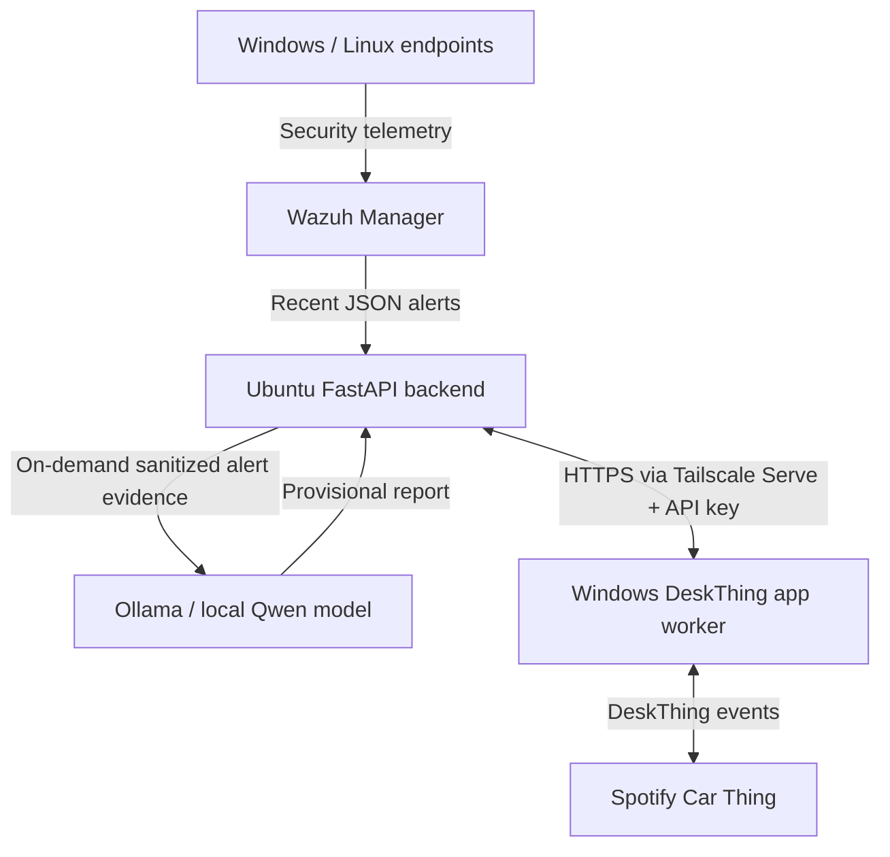

# CarThing SOC AI — A Miniature SOC Console on Spotify Car Thing

**A personal cybersecurity home-lab project:** a repurposed Spotify Car Thing becomes a compact security monitoring and *on-demand* AI-assisted investigation dashboard.

**Status:** Working on the author's home lab; this is a **portfolio / experimental project**, not a production security appliance. Current DeskThing client app version: **v1.4.1**. The API service is composed from the v1.1 base, v1.3 Wazuh enrichment, and v1.4 on-demand AI patch.

> **Screenshots:** Add redacted screenshots or a 20–30 second demo clip under `docs/screenshots/`. Include (1) physical Car Thing on the Overview page, (2) Security alert list, (3) one selected alert, and (4) AI summary. Do not post an offline/error state as the only demo image. The sample screenshots are intentionally not included in this repository to prevent exposing private infrastructure details.

## What it does

- Displays **Ubuntu server health**, Docker services, Tailscale connectivity, and recent Wazuh alerts.
- Provides four touchscreen pages: **Overview / Security / Services / Network**.
- Uses the Car Thing **rotary knob and button** through DeskThing input-action mappings.
- Lets an analyst **tap a Wazuh alert**, inspect the available event fields, and request an **on-demand Ollama investigation**.
- Displays an AI-generated **summary, provisional assessment, supporting evidence, alternate explanation, suggested next steps, and limitations**.
- Supplies a fixed reference for selected Windows Event IDs, plus basic contradiction checks; the AI is **not a source of ground truth**.
- Requires an API key; keeps that key on the Windows bridge, not on the Car Thing screen.

## Architecture



The AI is **invoked only after a user presses Investigate**, not for every incoming Wazuh event. Backend analysis jobs can take time on a CPU-only system. Wazuh rules detect; the language model explains and suggests investigation steps.

## Tech stack

| Layer | Technologies |
| --- | --- |
| Hardware / display | Spotify Car Thing, ThingLabs firmware, DeskThing client |
| Client app | TypeScript, React, Vite, DeskThing SDK |
| Windows bridge | DeskThing background worker, Node.js |
| Secure transport | Tailscale Serve HTTPS |
| Backend | Ubuntu, Python, FastAPI, systemd |
| Security telemetry | Wazuh Manager, JSON alerts |
| Local AI | Ollama, Qwen-family model |
| Monitoring | Docker, host CPU/RAM/disk, Tailscale |

## Repository structure

```text
.
├── deskthing-app/     # Car Thing UI and Windows DeskThing worker
│   ├── src/
│   ├── server/
│   ├── scripts/
│   ├── tests/
│   └── deskthing/
├── ubuntu-backend/    # FastAPI data collectors + AI jobs
│   ├── app/
│   ├── scripts/
│   └── tests/
├── docs/              # Redacted screenshot placeholders and post guidance
├── .gitignore
└── README.md
```

## Quick start (developer overview)

### 1) Ubuntu backend

Use a dedicated Ubuntu host with Docker and a configured Wazuh Manager. Set up a virtual environment and install the requirements:

```bash
cd ubuntu-backend
python3 -m venv .venv
source .venv/bin/activate
pip install -r requirements.txt
cp .env.example .env
```

Generate a **fresh random** `CARTHING_API_KEY` (at least 24 characters), configure Wazuh settings in `.env`, and run the included setup instructions in `ubuntu-backend/README.md`. Never commit `.env` or production credentials.

**Wazuh mode:** This repository's v1.4 AI worker currently supports `WAZUH_MODE=docker` for on-demand analysis, and requires access to Wazuh Manager's alert log. See `ubuntu-backend/.env.example`.

**Ollama:** Install Ollama locally; pull a model such as `qwen3:1.7b` and ensure it responds on `http://127.0.0.1:11434`. To choose another installed model, set `SOC_AI_MODEL` in the backend process environment. A larger model may produce better explanations but may be slower. Avoid exposing Ollama publicly.

Serve the localhost-bound API over your tailnet using Tailscale Serve. Do not directly port-forward Wazuh, Docker, or Ollama to the Internet.

### 2) Windows DeskThing application

```powershell
cd deskthing-app
npm install
npm test
npm run build
```

Configure the **Windows bridge**, not the Car Thing, with your own private HTTPS endpoint and API key:

```powershell
powershell -NoProfile -ExecutionPolicy Bypass -File .\scripts\configure-windows.ps1
powershell -NoProfile -ExecutionPolicy Bypass -File .\scripts\test-bridge.ps1
```

In DeskThing, install the ZIP produced in `dist/` using **Downloads → Add App**. Keep DeskThing running on Windows and the Car Thing connected. Configure **Clients → Mapping → Wheel** to link scroll directions to `SOC: Next screen` and `SOC: Previous screen`, and Enter to `SOC: Refresh now`. Start the app in **Apps**.

### 3) Investigate an alert

**Security → select a real Wazuh alert → Investigate with AI → review provisional summary and evidence.** You can expand the report for next steps and limitations. No auto-remediation is performed. Responses that contradict known Windows event definitions may be marked unreliable; false-positive/true-positive conclusions require human validation.

## Testing

```bash
# On Ubuntu (with Python dependencies installed)
cd ubuntu-backend
python3 -m pytest -q
```

```powershell
# On Windows
cd deskthing-app
npm test
npm run build
```

Automated tests cover representative event normalization and investigation data paths. This is not a penetration test or production-level validation; model accuracy and end-to-end hardware behavior require hands-on verification.

## Scope and limitations

- **AI answers can be wrong.** During development, a local model incorrectly described Windows Events 4688 and 5038. The interface makes verdicts provisional and includes a small fixed event ID reference plus checks; this does **not** fully prevent hallucination.
- **TP / FP** are alert-review labels; **FN / TN** cannot be inferred by clicking an alert and require separate detection-validation exercises.
- Correlation currently covers a **bounded sample of recent Wazuh alert records**, not the full SIEM history or raw endpoint forensics.
- The current Python backend uses Docker access to read Wazuh alerts. Although the AI has no arbitrary command tool and the application implements read-only behavior, **membership in the Docker group or Docker socket access is highly privileged**. For production, replace this with a least-privileged alert export / dedicated read-only feed.
- AI jobs and results currently live in backend process memory; they can be lost after service restart.
- This is a **monitoring and educational tool**, not a substitute for endpoint protection, a dedicated SIEM, or analyst investigation.

## Security / privacy

**Never commit:** `.env`, Windows `CarThingSOC/config.json`, API tokens, raw Wazuh logs, hostnames/tailnet addresses, Tailscale IPs, or screenshots containing user accounts, internal IPs, private file paths, session credentials, or device serial numbers. Rotate keys if they have ever been exposed.

See [SECURITY.md](SECURITY.md) for disclosure and local-development cautions.

## Possible future improvements

- Analyst-confirmed TP / FP / Inconclusive verdicts with a persistent investigation timeline.
- Group repeated benign alerts (e.g. vendor antivirus signing warnings) so bursts do not obscure new incidents.
- Snapshot-based regression tests using anonymized, analyst-verified examples (4625, 4688, 5038).
- Replace direct Docker access with a least-privilege Wazuh export.
- Export investigation summaries (Markdown/JSON) and collect model accuracy / latency metrics.

## Attribution

Independent home-lab project built with DeskThing, ThingLabs firmware, Wazuh, Tailscale, FastAPI, and Ollama. Not affiliated with Spotify or the named upstream projects. Respect their individual licenses. Add an explicit open-source license only after choosing one.
